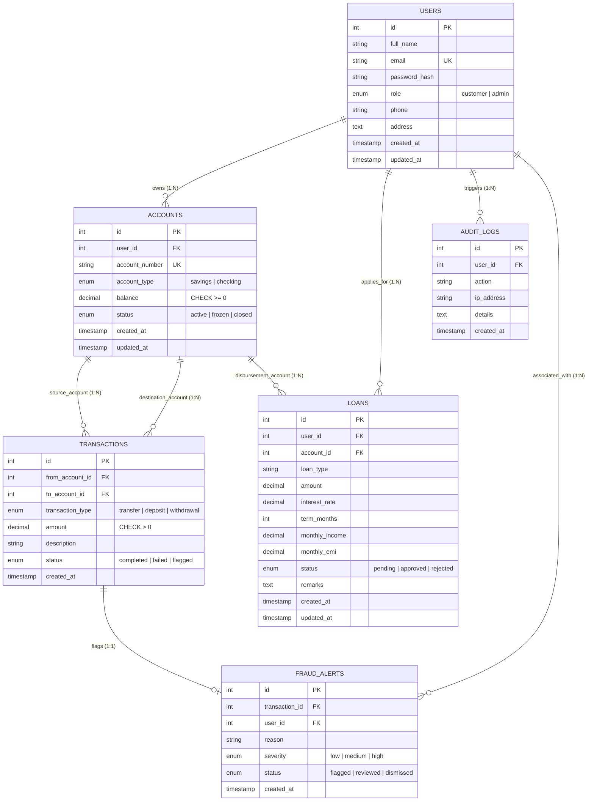

# 📊 FinTrack – Entity Relationship (ER) Diagram & Schema Design

## 1. Entity Relationship Diagram (ERD)

---

## 2. Relational Normalization (Up to 3NF)

### 1NF (First Normal Form)
- Every column contains **atomic (indivisible) values**.
- There are **no repeating groups** or arrays stored inside fields.
- Each table possesses a unique Primary Key (`id`).

### 2NF (Second Normal Form)
- Satisfies 1NF.
- There are **no partial dependencies**: every non-prime attribute is fully functionally dependent on the entire Primary Key.
- Composite relationships (e.g. Account-to-Account transactions) are normalized into a standalone `transactions` relation referencing foreign keys `from_account_id` and `to_account_id`.

### 3NF (Third Normal Form)
- Satisfies 2NF.
- There are **no transitive dependencies**: non-prime attributes do not depend on other non-prime attributes ($X \to Y \to Z$).
- User contact info (`phone`, `address`) lives in `users`, not duplicated inside `accounts` or `transactions`.
- Account balance and state reside strictly in `accounts`, avoiding redundant denormalized copies.

---

## 3. Integrity Constraints & Business Rules

1. **Domain Integrity**:
   - `accounts.balance >= 0.00` enforced by `chk_positive_balance`.
   - `transactions.amount > 0.00` enforced by `chk_positive_amount`.
2. **Referential Integrity**:
   - Foreign Keys with explicit `ON DELETE CASCADE` or `ON DELETE SET NULL`.
3. **Entity Integrity**:
   - Unique constraints on `users.email` and `accounts.account_number`.

